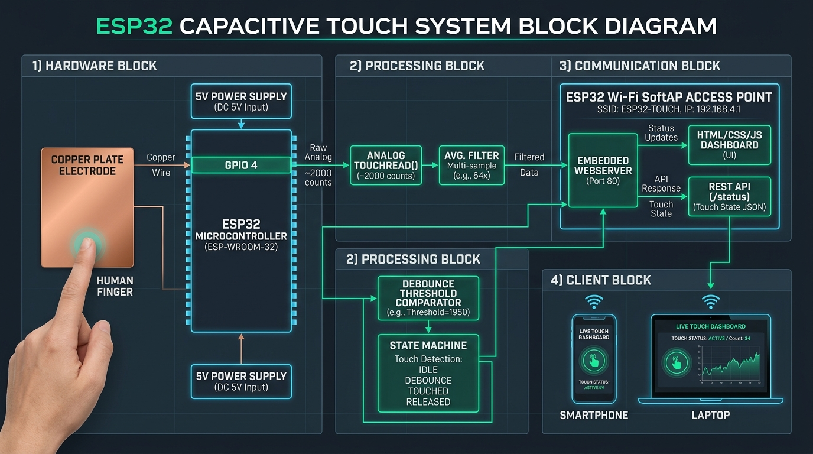
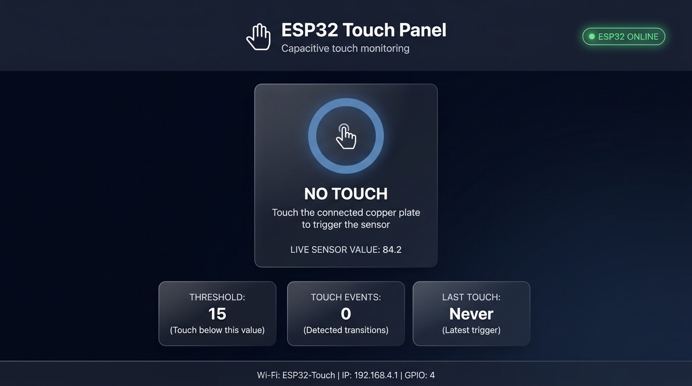
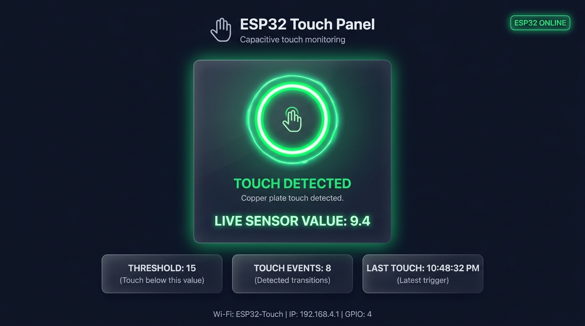
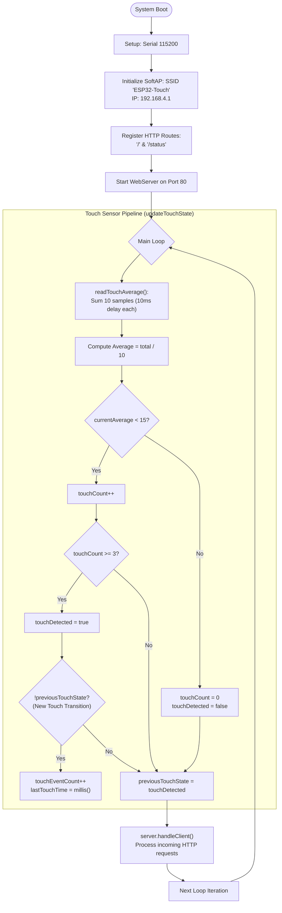
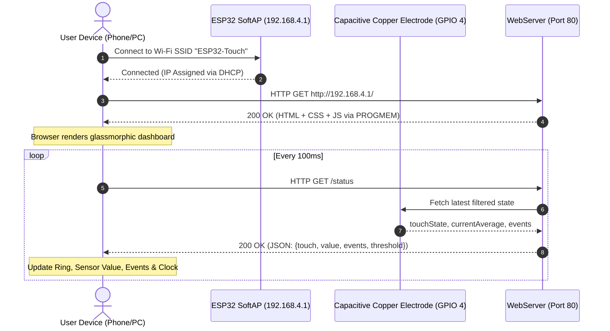

# ✋ ESP32 Capacitive Touch & Wi-Fi Access Point Dashboard

[](https://www.espressif.com/)
[](https://www.arduino.cc/)
[](https://en.wikipedia.org/wiki/SoftAP)
[](https://developer.mozilla.org/en-US/docs/Web/CSS)
[](LICENSE)

A standalone ESP32 capacitive touch sensing solution paired with an integrated Wi-Fi Access Point and an ultra-modern glassmorphic web dashboard. The device operates with zero external network dependencies, serving live touch telemetry, event tracking, and analog capacitance readings directly to any connected phone, tablet, or PC browser.

---

## 🏛️ System Block Diagram

<div align="center">
  
</div>

<br/>

### 📋 About the System Blocks

| System Block | Sub-Components | Technical Responsibility |
| :--- | :--- | :--- |
| **1) Hardware Block** | • ESP32 DevKit (ESP-WROOM-32)<br/>• Copper Plate Electrode<br/>• GPIO 4 (`TOUCH0`)<br/>• 5V DC Power Supply | Forms the capacitive touch transducer. The copper plate forms an electrode whose parasitic capacitance to ground changes dramatically upon human contact. |
| **2) Processing Block** | • `touchRead(4)` Analog Sampling<br/>• 10-Sample Averaging Filter<br/>• Debounce Threshold Comparator (`< 15`)<br/>• State Machine (`NO TOUCH` $\leftrightarrow$ `TOUCHED`) | Filters high-frequency EMI and 50/60Hz mains noise. Validates that 3 consecutive cycles fall below threshold before triggering edge transitions and counting events. |
| **3) Communication Block** | • ESP32 SoftAP Wi-Fi (`192.168.4.1`)<br/>• Port 80 WebServer<br/>• Flash Memory `PROGMEM` Storage<br/>• JSON REST API (`/status`) | Broadcasts standalone Wi-Fi SSID `ESP32-Touch` with DHCP server. Serves compressed single-page dashboard and live JSON status updates without internet access. |
| **4) Client Block** | • Smartphone Web Browser<br/>• Laptop / Tablet Web Browser<br/>• JavaScript Polling Engine (100ms) | Renders the real-time glassmorphic UI, updates the live sensor reading, tracks event timestamps, and animates the pulsing radar glow ring. |

---

## 🖥️ Live Web Dashboard Visuals

Whenever the ESP32 is powered and the user connects to `http://192.168.4.1`, the responsive glassmorphic dashboard displays the current sensor status in real time:

### 1. Idle State — No Touch Detected

<div align="center">
  
</div>

<br/>

#### ℹ️ About the Idle State Interface
| Interface Element | Display Value / Status | Description |
| :--- | :--- | :--- |
| **Connection Badge** | `ESP32 ONLINE` (Green Dot) | Indicates healthy HTTP polling communication with the ESP32 server. |
| **Touch Ring** | Calm Blue Border & Glow | Sensor is in resting state; no physical touch contact. |
| **Status Heading** | `NO TOUCH` | Firmware state machine confirms capacitance is within baseline. |
| **Live Sensor Value** | `~84.2` | High baseline capacitive reading (typical resting value: 70–95). |
| **Stat Cards** | • **Threshold:** `15`<br/>• **Touch Events:** `0`<br/>• **Last Touch:** `Never` | Shows active threshold line, zero transition triggers, and idle history. |
| **Device Info Bar** | `SSID: ESP32-Touch` \| `IP: 192.168.4.1` \| `GPIO: 4` | Shows active AP network settings and pin assignment. |

---

### 2. Active State — Copper Plate Touched

<div align="center">
  
</div>

<br/>

#### ℹ️ About the Touched State Interface
| Interface Element | Display Value / Status | Description |
| :--- | :--- | :--- |
| **Touch Ring** | Emerald Green Glow (`#4ade80`) + Radar Pulse | Dynamic keyframe animation (`touchPulse`) and scaling (`1.04x`). |
| **Status Heading** | `TOUCH DETECTED` | Capacitive reading dropped below threshold for $\ge 3$ consecutive samples. |
| **Live Sensor Value** | `~9.4` (Glowing Green) | Reflects the sharp drop in charge cycle count caused by human capacitance. |
| **Touch Events Count** | Incremented (e.g. `8`) | Edge detector increments counter exactly once per physical touch transition. |
| **Last Touch Clock** | Local Time (e.g. `10:48:32 PM`) | Captures the exact moment the transition occurred from client local clock. |

---

## 📖 What This Code Does

This project integrates low-level analog hardware sensing, real-time signal processing, networking, and modern frontend web engineering into a single self-contained ESP32 sketch:

### 1. Capacitive Touch Sensing (`touchRead`)
- Utilizes the ESP32 internal capacitive peripheral on **GPIO 4** (`TOUCH0`).
- Unlike standard digital pushbuttons, capacitive pins detect changes in electrical capacitance induced when a human touches a conductive surface (e.g., copper plate or foil).
- The sensor reading **decreases** when touched (baseline resting value is typically ~70-90, dropping below 15 upon direct or proximate touch).

### 2. Multi-Sample Averaging (Noise Filtration)
- In [`readTouchAverage()`](esp32_capacitive_touch_dashboard.ino), the ESP32 takes **10 samples** spaced by 10ms intervals and calculates the arithmetic mean:
  $$\text{Average} = \frac{1}{10} \sum_{i=1}^{10} \text{touchRead}(4)$$
- This filters out electromagnetic interference (EMI), 50/60Hz mains hum, and high-frequency RF noise.

### 3. Debouncing & Edge-Triggered State Machine
- **Threshold Check:** Evaluates whether `currentAverage < TOUCH_THRESHOLD (15)`.
- **Debounce Confirmation:** Requires **3 consecutive loop cycles** (`REQUIRED_TOUCH_COUNT = 3`) below the threshold before setting `touchDetected = true`. This prevents transient spikes or ghost touches.
- **Transition Detection (Edge Trigger):** Detects only the state transition from `NO TOUCH -> TOUCH` (`!previousTouchState`), incrementing `touchEventCount` and logging `lastTouchTime = millis()`. Releasing the sensor resets the counter smoothly.

### 4. Standalone Wi-Fi Access Point (SoftAP)
- The ESP32 broadcasts its own Wi-Fi network without requiring an external internet connection or router:
  - **SSID:** `ESP32-Touch`
  - **Password:** `128-12345678`
  - **IP Address:** `192.168.4.1` (configured via `WiFi.softAPConfig`)
- Any Wi-Fi enabled client (smartphone, laptop) can connect directly to the ESP32.

### 5. Embedded HTTP Web Server & JSON API
- Hosts a dual-endpoint lightweight web server on port `80`:
  - **`GET /`**: Serves the complete single-page application (SPA) stored in Flash memory using `PROGMEM` (`server.send_P`), conserving RAM.
  - **`GET /status`**: Returns real-time sensor telemetry as JSON:
    ```json
    {
      "touch": true,
      "value": 9.4,
      "events": 8,
      "threshold": 15
    }
    ```
  - **`NotFound` (404)**: Graceful fallback for non-existent routes.

### 6. Modern Glassmorphic Web Dashboard
- **Design System:** Deep slate dark background (`#020617`, `#0f172a`, `#1e293b`), semi-transparent frosted cards with `backdrop-filter: blur(14px)`, and vibrant gradients.
- **Dynamic Touch Indicator:** An interactive touch ring that smoothly expands (`transform: scale(1.04)`), transitions from blue to electric green (`#4ade80`), and emits continuous glowing radar pulses (`@keyframes touchPulse`) when touched.
- **Asynchronous Live Polling:** Client-side JavaScript polls `/status` every 100ms via `fetch()`, updating the DOM in real time with zero screen flicker.
- **Connection Watchdog:** Displays a pulsing green status badge (`ESP32 ONLINE`), switching automatically to `CONNECTION ERROR` if network packets fail.
- **Responsive Layout:** Adaptive Flexbox and CSS Grid layout with mobile breakpoint styling for screens under 700px.

---

## 📊 Flowcharts & System Logic

### 1. Firmware Execution Flowchart


---

### 2. Client-Server Interaction Flowchart


---

## 🛠️ Hardware Setup & Pinout

### Required Components
| Component | Quantity | Purpose |
| :--- | :---: | :--- |
| **ESP32 DevKit V1 (30 or 38 pin)** | 1 | Microcontroller with Wi-Fi & Capacitive Touch |
| **Copper Plate or Copper Foil Tape** | 1 | Touch electrode surface |
| **Jumper Wire (Dupont)** | 1 | Connects GPIO 4 to the copper plate |
| **Micro-USB / USB-C Cable** | 1 | Power & programming |

### Wiring Diagram
```text
  +--------------------+
  |    ESP32 DevKit    |
  |                    |
  |             GPIO 4 +-------------------------> [ Copper Plate / Foil ]
  |            (TOUCH0)|        (Jumper Wire)          (Touch Surface)
  |                    |
  |                GND +---- (Optional: Earth / shield reference if needed)
  |                    |
  |                 5V +<--- Powered via USB (5V 1A adapter or PC port)
  +--------------------+
```

---

## ⚙️ Configuration Reference

All core thresholds and network credentials can be customized at the top of [`esp32_capacitive_touch_dashboard.ino`](esp32_capacitive_touch_dashboard.ino):

| Constant | Default Value | Description |
| :--- | :---: | :--- |
| `TOUCH_PIN` | `4` | ESP32 Capacitive Touch Pin (`TOUCH0`) |
| `NUM_SAMPLES` | `10` | Number of analog readings per measurement cycle |
| `TOUCH_THRESHOLD` | `15` | Values lower than this are registered as touch candidates |
| `REQUIRED_TOUCH_COUNT` | `3` | Consecutive cycles needed below threshold to validate a touch |
| `AP_SSID` | `"ESP32-Touch"` | Wi-Fi network name broadcasted by ESP32 |
| `AP_PASSWORD` | `"128-12345678"` | WPA2 password for the SoftAP |
| `local_IP` | `192.168.4.1` | Static IP of the ESP32 server |

---

## 🚀 Getting Started

### 1. Arduino IDE Setup
1. Open **Arduino IDE** (v1.8+ or v2.x).
2. Go to **File > Preferences** and add the ESP32 board manager URL:
   ```text
   https://raw.githubusercontent.com/espressif/arduino-esp32/gh-pages/package_esp32_index.json
   ```
3. Go to **Tools > Board > Boards Manager**, search for `esp32`, and install **esp32 by Espressif Systems**.
4. Select your board: **Tools > Board > ESP32 Arduino > ESP32 Dev Module**.
5. Select the correct COM port under **Tools > Port**.
6. Set Upload Speed to `921600` and Flash Frequency to `80MHz`.

### 2. Flashing the Code
1. Open [`esp32_capacitive_touch_dashboard.ino`](esp32_capacitive_touch_dashboard.ino).
2. Click the **Upload** button ($\rightarrow$).
3. Once flashing completes, open **Tools > Serial Monitor** at **115200 baud**.
4. Confirm the startup log:
   ```text
   =================================
    ESP32 CAPACITIVE TOUCH PANEL
   =================================
   Access Point started
   SSID: ESP32-Touch
   Password: 128-12345678
   IP address: 192.168.4.1

   Web server started.
   Open this in your browser:
   http://192.168.4.1
   ```

### 3. Accessing the Dashboard
1. On your phone or laptop, open Wi-Fi settings and connect to:
   - **SSID:** `ESP32-Touch`
   - **Password:** `128-12345678`
2. Open any web browser (Chrome, Safari, Firefox, Edge) and navigate to:
   ```text
   http://192.168.4.1
   ```
3. Touch the copper plate connected to GPIO 4 and watch the dashboard react in real time!

---

## 📄 License
This project is open-source and released under the [MIT License](LICENSE).
